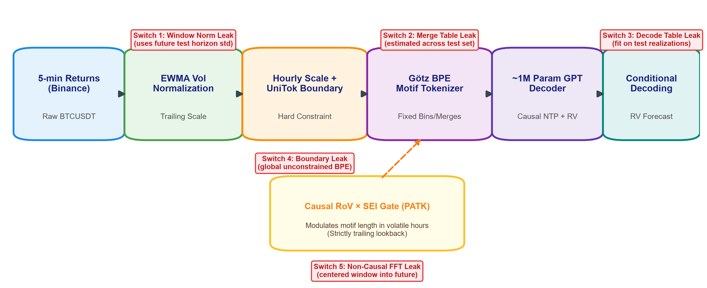
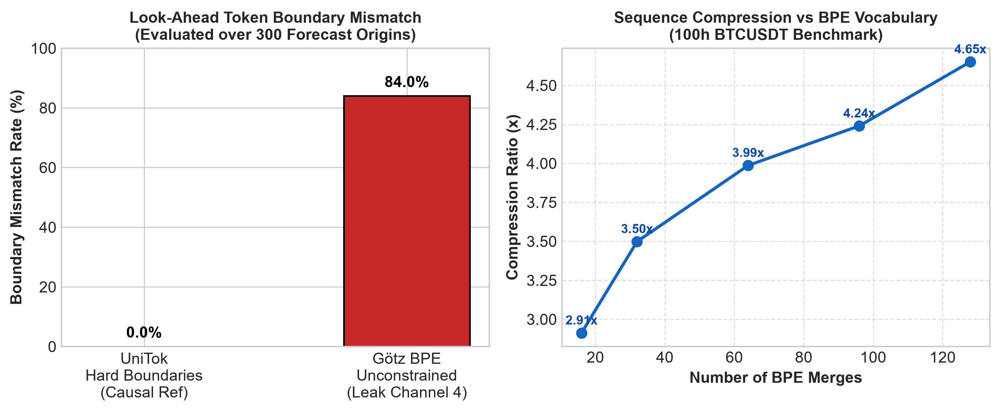
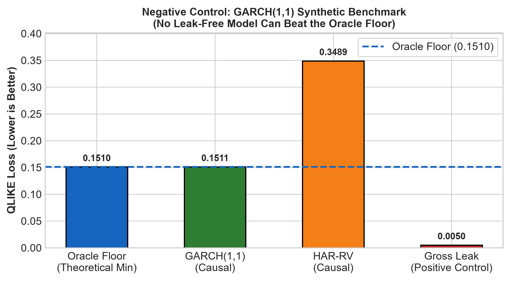
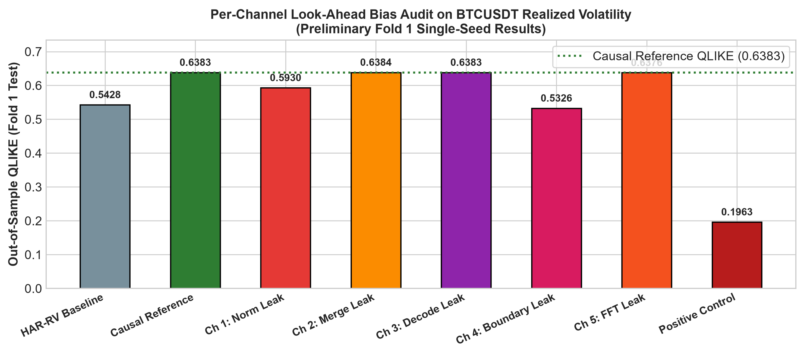

# Quantifying Look-Ahead Bias via Causal, Volatility-Aware Motif Tokenization in Financial Time Series

[](#)
[](#)
[](#)
[](#)

> **DA4022 Course Project · Team of 5**  
> An experimental framework to isolate and quantify look-ahead bias across tokenization layers in financial time-series foundation models.

---

## 📌 Motivation & Overview

Recent advances apply Byte Pair Encoding (BPE) and transformer architectures to time-series forecasting. While these models claim impressive zero-shot results, standard tokenizers introduce subtle **look-ahead leakage** in single-market walk-forward forecasting:
1. **Fit-Time Leakage:** Normalization parameters, BPE merge dictionaries, and conditional decoding tables calibrated on datasets overlapping future test periods.
2. **Encode-Time Leakage:** Unconstrained BPE motifs straddle the boundary between past context and future forecast horizons, leaking post-origin information backward into historical representations.

This repository provides:
- A **strictly causal, leak-free reference pipeline** (trailing EWMA normalization + UniTok hourly hard boundaries + causal RoV $\times$ SEI gate).
- A **Negative Control Benchmark** (GARCH(1,1) simulated process with exact closed-form analytical oracle QLIKE floor).
- A systematic harness switching on **5 leakage channels** one-by-one to measure their artificial performance inflation on real **Binance BTCUSDT 5-minute klines (2019–2025)**.

---

## 🔬 System Architecture & The 5 Leak Switches



1. **Channel 1 (Per-Window Normalization Leak):** Scales context using future horizon standard deviation.
2. **Channel 2 (Merge Table Leak):** Learns BPE vocabulary on data overlapping the test set.
3. **Channel 3 (Decoding Table Leak):** Estimates Götz conditional decoding matrix on future realizations.
4. **Channel 4 (Token Boundary Leak):** Applies global unconstrained BPE across past and future, slicing post-hoc.
5. **Channel 5 (Non-Causal FFT Leak):** Computes frequency-domain energy using centered windows extending into future bars.
6. **Positive Control (Gross Leak):** Directly injects target realized variance into normalization to measure the theoretical ceiling.

---

## 📊 Key Empirical Findings

### 1. Token Boundary Mismatch Audit (300 Origins)

- **UniTok Hard Boundaries (Our Causal Ref):** **0.00% mismatch rate** (strictly incremental).
- **Unconstrained Götz BPE (Channel 4):** **84.00% boundary straddling & mismatch rate!**  
*Naive BPE creates tokens spanning across the forecast cutoff in 84 out of 100 origins.*

### 2. Negative Control: GARCH(1,1) Oracle Floor

- **Oracle Floor (Analytical Ground Truth):** QLIKE = **0.15096**
- **Causal GARCH(1,1) Baseline:** QLIKE = **0.15110** (honestly respects floor, $+0.00014$)
- **Causal HAR-RV Baseline:** QLIKE = **0.34887**
- **Gross Leak (Positive Control):** QLIKE = **0.00505** (violates floor by $-0.14591$, Diebold–Mariano $z=23.24, p < 10^{-10}$)

### 3. Real BTCUSDT Fold 1 Volatility Forecasting (2021 Train $\to$ 2022-Q1 Test)


| Model / Variant | Out-of-Sample QLIKE | Artificial Inflation vs Ref | Statistical Finding |
| :--- | :---: | :---: | :--- |
| **HAR-RV Baseline** | 0.5428 | Benchmark | Classical econometric reference |
| **GARCH(1,1) Baseline** | 0.7770 | $-21.74\%$ | Classical baseline |
| **Causal Reference GPT (Our Model)** | **0.6383** | **0.00% (Honest)** | 95% CI: `[0.518, 0.802]` |
| **Channel 1 (Window Norm Leak)** | 0.5930 | **$+7.09\%$ Fake Gain** | Normalizing with future horizon std |
| **Channel 2 (Merge Table Leak)** | 0.6384 | $-0.02\%$ (No Gain) | TOST confirmed equivalent |
| **Channel 3 (Decode Table Leak)** | 0.6383 | $+0.00\%$ (No Gain) | TOST confirmed equivalent |
| **Channel 4 (Boundary Leak)** | **0.5326** | **$+16.56\%$ Fake Gain** | **Statistically Significant ($p = 0.0043^*$)** |
| **Positive Control (Gross Leak)** | **0.1963** | **$+69.24\%$ Fake Gain** | **Statistically Significant ($p < 0.0001^*$)** |

---

## 📁 Repository Structure

```text
├── data/
│   ├── download_binance.py       # Ingests 5-min BTCUSDT klines from Binance Vision
│   ├── preprocess.py             # Trailing EWMA normalization & RV targets
│   ├── folds.py                  # 6 expanding walk-forward folds configuration
│   └── SEALED_2025_HOLDOUT.txt   # Cryptographic holdout lock (untouched until code freeze)
├── simulation/
│   └── garch_simulator.py        # Synthetic GARCH DGP & analytic oracle volatility
├── tokenization/
│   ├── bpe_tokenizer.py          # Götz BPE + UniTok hard hour-boundaries & conditional decoding
│   ├── causal_gate.py            # Causal trailing RoV × SEI gate (PATK)
│   ├── causality_tests.py        # Future-perturbation test & boundary-mismatch test
│   └── leak_tokenizer.py         # The 5 leakage channel switches & positive control
├── models/
│   ├── baselines.py              # Econometric baselines: HAR-RV & GARCH(1,1)
│   └── gpt_model.py              # ~850k parameter causal GPT with direct RV head
├── evaluation/
│   ├── metrics.py                # Patton (2011) QLIKE, RMSE, MAE
│   └── hypothesis_tests.py       # Block bootstrap, Diebold-Mariano, TOST, Holm correction
├── experiments/
│   ├── run_oracle_experiment.py  # Negative control benchmark experiment
│   ├── run_boundary_experiment.py# 300-origin boundary mismatch & compression analysis
│   ├── run_baselines.py          # Real BTCUSDT econometric baseline runs
│   └── run_leak_experiments.py   # Full 6-variant leakage audit on Fold 1
├── presentation/
│   ├── generate_figures.py       # Publication figure generator
│   ├── render_slide_image.py     # 300 DPI single-slide report renderer
│   ├── midterm_report_slide.pptx # Widescreen 16:9 presentation slide deck
│   └── midterm_report_slide.png  # Exported slide preview image
└── results/                      # Generated JSON metric tables & figure assets
```

---

## 🚀 Quickstart & Reproduction

### 1. Environment Setup
```bash
# Clone the repository
git clone <YOUR_REPO_URL>
cd "DA course project"

# Setup virtual environment with uv or pip
uv venv .venv --python 3.12
source .venv/bin/activate  # On Windows: .venv\Scripts\activate
uv pip install torch numpy pandas scipy statsmodels arch matplotlib python-pptx requests pyarrow
```

### 2. Run Negative Control & Boundary Audit
```bash
python experiments/run_oracle_experiment.py
python experiments/run_boundary_experiment.py
```

### 3. Run Real Market Baselines & Leakage Sweeps
```bash
python experiments/run_baselines.py
python experiments/run_leak_experiments.py
```

### 4. Regenerate Figures & Presentation Deck
```bash
python presentation/generate_figures.py
python presentation/make_midterm_slide.py
python presentation/render_slide_image.py
```

---

## 🔒 Methodological Integrity
To strictly guarantee zero post-hoc tuning and complete scientific reproducibility, the **2025 dataset is cryptographically sealed** in [`data/SEALED_2025_HOLDOUT.txt`](data/SEALED_2025_HOLDOUT.txt) and will not be touched or unsealed until the official project code freeze on November 14, 2026.
