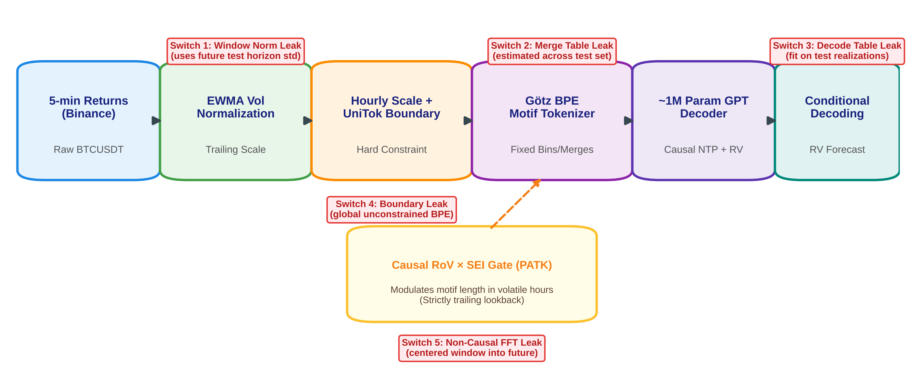
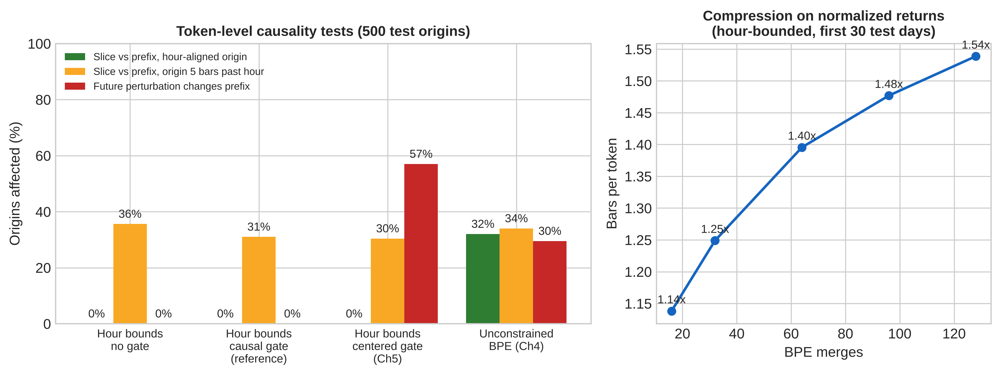
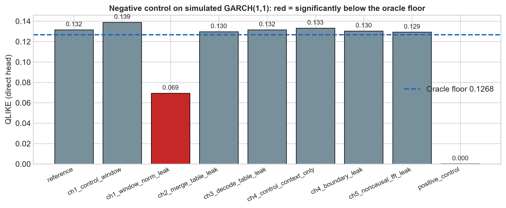
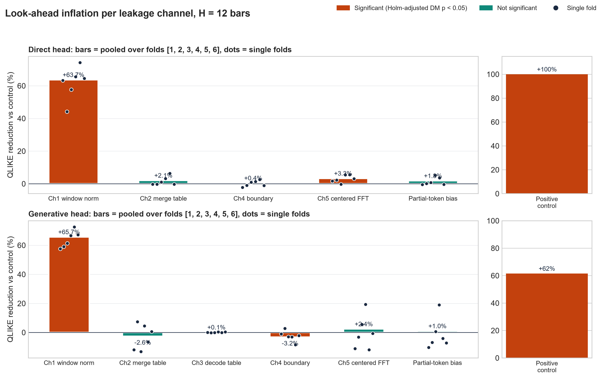
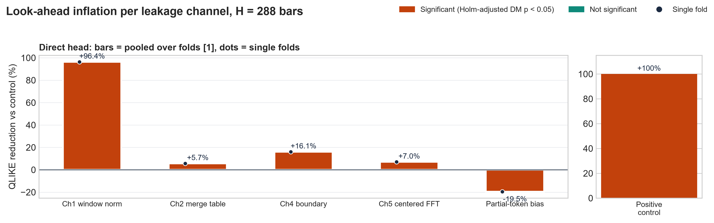
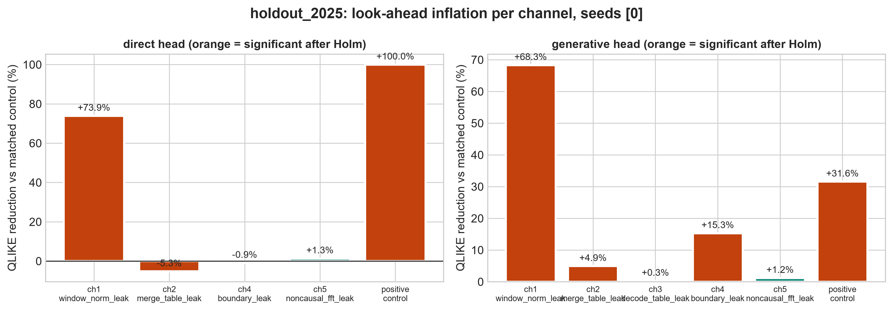
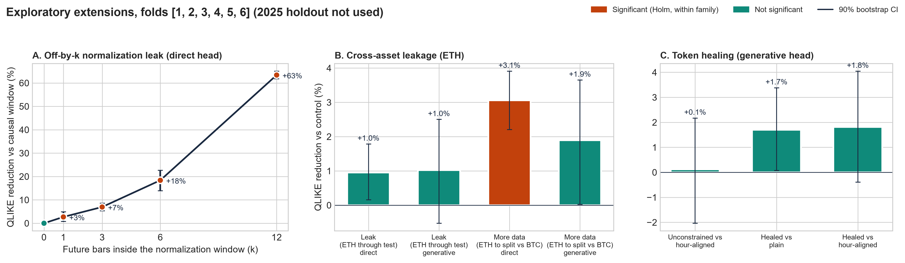

# Quantifying Look-Ahead Bias via Causal, Volatility-Aware Motif Tokenization in Financial Time Series

**DA4022 Course Project · Devansh Jangid, Aman Gupta, Arnav Tiku, Sanidhya Srivastava, Karan Malik · Technical notes (26 Nov 2026)**

> These are the detailed technical notes. The submitted 5-page report is [`report/final_report.pdf`](report/final_report.pdf).

Code: `https://github.com/devanshjangid2005/causal-vol-tokenizer` (results in this report: branch `feat/extensions`, commit `273507c`).

---

## Abstract

BPE motif tokenizers for time series are usually validated zero-shot on held-out datasets. When they are used
for walk-forward forecasting on a single market, they can leak future information. This happens at fit time,
through normalization statistics, merge tables or decoding tables estimated on test-period data. It also happens
at encode time, because rank-ordered BPE is not incremental at an arbitrary forecast origin. We build a causal
reference pipeline for 5-minute BTCUSDT volatility forecasting. It combines hour-bounded Götz-style BPE, hourly
volatility scale tokens, a causal RoV×SEI gate on token length, and an 855,169-parameter GPT with a direct
forecast head and a generative forecast head. We then switch on one leakage channel at a time, each against a
matched control, in training and testing alike.

We evaluate over six expanding walk-forward folds (26,290 hourly test origins, 2022–2024), a synthetic GARCH
negative control with a known oracle floor, and a 2025 holdout that was scored exactly once. One channel
dominates. When the normalization window reaches into the forecast horizon (Ch1), QLIKE falls by **63.39%**
(direct head; 3-seed pooled; 90% CI 61.77–65.04%). The random-effects estimate across folds is 62.03% with no
between-fold heterogeneity (I² = 0%). On simulated data, Ch1 is the only leakage channel that beats the
analytic oracle floor. Even one future bar in the window inflates accuracy by 2.70%.

At the next-hour horizon, the table leaks (Ch2, Ch3) and the encode-time leaks (Ch4, Ch5) move QLIKE by
between −2.58% and +1.78%. Only one of the four is significant per forecast head after Holm correction (Ch5
on the direct head, Ch3 on the generative head), and the 90% equivalence bounds cap each of them at +2.84% or
less. The token-boundary leak and partial-token bias are both small
on average at H = 12. In the two single-seed settings where partial-token bias is large, however, the boundary
leak recovers almost all of it. Those settings are the next-day horizon (Fold 1) and the 2025 holdout
generative head. In both, a leaky "tokenize-then-split" pipeline scores almost exactly like the causal
reference.

On the folds, the leak-free GPT direct forecasters form the Model Confidence Set. On the 2025 holdout, only
GARCH(1,1) remains in it.

---

## 1. Research question and contributions

**Question.** Which parts of a BPE motif-tokenization pipeline leak post-origin information in walk-forward
volatility forecasting, and by how much does each one inflate measured accuracy?

**Contributions.**

1. **A per-channel leakage audit inside a time-series tokenizer.** There are five channels: per-window
   normalization, merge table, decoding table, token boundaries, and a non-causal FFT gate. Each one is
   switched on alone against a matched control that differs in that one switch, and each leaky arm trains
   its own model with the leak present in both training and testing.
2. **The trade-off between token-boundary leakage and partial-token bias.** Tokenizing the stream once and
   then splitting it lets the token that straddles the origin carry future information. Tokenizing the
   context alone leaves a partial final token. We measure both against the same hour-aligned causal
   reference.
3. **A causal tokenizer design.** We use UniTok-style hard hour boundaries, hourly scale tokens carrying
   absolute EWMA volatility, and a causal RoV×SEI gate whose mechanism we borrow from PATK. The gate shortens
   tokens in volatile hours. Together these make encoding incremental at every hour-aligned origin, and we
   verify that empirically (Section 8.1).
4. **An evaluation protocol with controls.** It has six expanding walk-forward folds, a synthetic GARCH(1,1)
   negative control with an analytic oracle floor, a positive control, a 2025 holdout scored exactly once,
   and exploratory extensions confined to the folds (Ch1 dose-response, token healing, cross-asset leakage,
   and extra seeds). Statistics are QLIKE with moving-block bootstrap CIs, Diebold–Mariano tests with Holm
   correction, Giacomini–White and TOST tests, DerSimonian–Laird random-effects pooling across folds, and a
   Model Confidence Set.

---

## 2. Background

* **Götz-style BPE motif tokenization (Götz et al., 2026).** Normalized returns are quantized into fixed
  uniform bins, and a merge table is learned by byte-pair encoding. Merges are applied in rank order.
  Conditional decoding tables `E[x_i | b_i, b_{i-1}]` and `E[x_i^2 | b_i, b_{i-1}]` map generated bins back to
  values.
* **Incremental tokenization (Zhang et al., 2026, UniTok).** Zhang et al. define a tokenizer as incremental
  when encoding a prefix gives a prefix of the encoding of the full series. **We apply their definition to
  BPE.** A rank-ordered BPE stream is not incremental at an arbitrary cut point, so a stream tokenized once
  and then cut at the origin can carry post-origin information. Zhang et al. do not study BPE themselves.
  We adopt their hard-boundary idea by never merging across a clock hour.
* **Partial-token bias (Phan et al., 2024).** A model conditioned on a possibly truncated final token makes
  biased next-token predictions. Token healing is the standard heuristic remedy.
* **PATK (Liao et al., AAAI-26).** We borrow only the **RoV × SEI mechanism** (rate of variation times
  spectral energy intensity around a dominant frequency) as a score for when to shorten tokens. We do not
  use PATK's benchmark results as evidence for anything in this report.
* **Cross-asset leakage (Meyer et al., 2025).** A model trained on a different but correlated series that
  covers the test period can benefit from it even if no test observation of the target series was seen.

---

## 3. Data and experimental setup

### 3.1 Data

* **Source:** Binance Spot 5-minute klines (`data/download_binance.py`). **BTCUSDT 2021-01 to 2025-12** is
  used for the folds and the holdout. **ETHUSDT 2021-01 to 2024-12** (420,555 bars) is used only in the
  cross-asset extension. *The proposal stated 2019–2025; the study as run starts in 2021.*
* **2025 timestamps:** Binance archives switched `open_time` from milliseconds to microseconds on 2025-01-01.
  The downloader detects and converts them (`FIXES.md`, 17 Nov).
* **Preprocessing** (`data/preprocess.py`):
  * Log returns `r_t = log(close_t / close_{t-1})`.
  * A bar is flagged non-contiguous if it does not directly follow the previous bar by 5 minutes, and its
    return is set to 0.
  * Strictly trailing EWMA volatility: `σ²_t = 0.94·σ²_{t-1} + 0.06·r²_{t-1}`, with initial vol 0.005.
  * Normalized return `x_t = r_t / max(σ_t, 1e-6)`. The EWMA is computed once over each fold's contiguous
    train+test frame, so it does not restart at the split.

### 3.2 Target and origins

At origin *t*, every model may use bars ≤ *t*−1 and is scored on

  **RV_H[t] = Σ_{k=0}^{H−1} r²_{t+k}**, with H = 12 (next hour) or H = 288 (next day).

Origins are chosen by timestamp (`minute == 0`) and are skipped if any bar in `[t−C, t+H)` is missing. The
context is C = 144 bars (12 h). Train origins are purged so that `t + H ≤ split`. HAR-RV, GARCH, the oracle
and every GPT arm are scored on the **same** origins and the same target (`data/folds.py`).

### 3.3 Walk-forward folds and holdout (`data/folds.py`, origin counts from `results/*.json`)

| Split | Train | Test | Train origins (H=12) | Test origins (H=12) |
|---|---|---|---:|---:|
| Fold 1 | 2021-01 – 2021-12 | 2022-Q1 | 8,657 | 2,160 |
| Fold 2 | 2021-01 – 2022-03 | 2022-Q2 | 10,817 | 2,184 |
| Fold 3 | 2021-01 – 2022-06 | 2022-H2 | 13,001 | 4,416 |
| Fold 4 | 2021-01 – 2022-12 | 2023-H1 | 17,417 | 4,330 |
| Fold 5 | 2021-01 – 2023-06 | 2023-H2 | 21,747 | 4,416 |
| Fold 6 | 2021-01 – 2023-12 | 2024 | 26,163 | 8,784 |
| **Pooled Folds 1–6** | | | | **26,290** |
| **2025 holdout** | 2021-01 – 2024-12 | 2025-01 – 2025-12 | 34,947 | 8,760 |

At H = 288 (Fold 1 only) there are 8,496 train and 2,137 test origins.

---

## 4. Pipeline

*Figure 1 (`pipeline_leak_switches.png`): the causal reference pipeline and where each of the five leakage
switches acts. The figure labels the model "~1M Param"; the exact count is 855,169.*

### 4.1 Tokenizer (`tokenization/bpe_tokenizer.py`)

* 32 uniform bins on normalized returns in [−4, 4], with fixed edges that are never fitted.
* 64 BPE merges learned on **train data only** and applied in rank order (Götz Alg. 2). With
  `enforce_hour_boundaries=True`, merges never cross a clock hour.
* 16 geometric **scale bins** on [1e−4, 0.05]. At each hour start, the absolute trailing EWMA volatility is
  quantized and emitted as a scale token before that hour's motifs.
* Vocabulary: 32 + 16 + 64 = **112** ids, plus a dedicated **PAD id 112** (embedding size 113).
* Conditional decoding tables `cond_mean = E[x_i | b_i, b_{i−1}]` and `cond_m2 = E[x_i² | b_i, b_{i−1}]` are
  fitted on train data. Bin pairs never seen in training fall back to the bin centers.

### 4.2 Causal RoV × SEI gate (`tokenization/causal_gate.py`)

* For the hour starting at bar *s*, the score is RoV × SEI over the **trailing** 24-bar window `[s−24, s)`.
  RoV is the mean absolute first difference. SEI is the share of non-DC spectral energy within ±1 frequency
  bin of the dominant frequency.
* The threshold is the 75th percentile of train-hour scores. Gated hours use only the first **16** of the 64
  merges, which gives shorter tokens. About 23% of Fold 1 test hours are gated (`FIXES.md` §5).

### 4.3 Model (`models/gpt_model.py`) and training (`experiments/run_leak_experiments.py`)

* `TimeSeriesGPT` is a decoder-only transformer with causal masking:
  * `d_model` = 128, 4 heads, 4 layers, feed-forward width 512, dropout 0.1, GELU, pre-norm.
  * Learned positional embeddings up to 192 tokens.
  * A linear LM head without bias.
  * A volatility head `128 → 64 → GELU → 1 → Softplus` (+1e−6).
  * **855,169 parameters.** This is the sum of 14,464 token-embedding, 24,576 positional, 4 × 198,272
    transformer-layer, 256 final-norm, 14,464 LM-head and 8,321 volatility-head parameters.
* Training settings:
  * 5 epochs, batch 64, AdamW (lr 1e−3, weight decay 1e−2), gradient clip 1.0.
  * Loss = **QLIKE**(pred, RV/scale²) + 0.5 × next-token cross-entropy, with PAD ignored.
  * Sequences are left-padded to 192 tokens.
* **Direct head:** the volatility head predicts RV/scale², which is then rescaled by scale².
* **Generative head (Götz-style):** sample future tokens autoregressively, with 8 samples at temperature 1.0
  and up to 3H+8 steps. Expand each sampled token to bins and sum `cond_m2[b_i, b_{i−1}]` over the next H
  bins, then rescale by scale². The decoding table (Ch3) acts only through this head.

### 4.4 Econometric baselines (`models/baselines.py`)

* **HAR-RV** (Corsi, 2009) by OLS on the sum of r² over the last 12, 288 and 2,016 bars (1 h, 1 day,
  1 week; crypto trades 24/7).
* **GARCH(1,1)** (Bollerslev, 1986) by Gaussian maximum likelihood on returns × 1000, with stationarity
  enforced by construction (α + β ≤ 0.9999). It is filtered causally, and multi-step variance is summed over
  the horizon. The `arch` package did not converge on Fold 6 (α + β = 1.01), so it was replaced
  (`FIXES.md`, 17 Nov).

---

## 5. Leakage arms (`tokenization/leak_tokenizer.py`)

Each leak arm differs from its matched control in exactly one switch. Every arm except Ch3 and the
paired-inference healing arm trains its own model with the switch on in training **and** testing. Ch3 reuses
the reference model, because decoding tables never enter training.

| Arm | Matched control | Single switch |
|---|---|---|
| `reference` | – | Per-bar trailing EWMA norm, hour boundaries, train-only merge/decode tables, causal gate, hourly scale tokens |
| `ch1_control_window` | – | Context scaled by `std(r[t−C : t])` (context only), then hour-aligned encoding |
| `ch1_window_norm_leak` | `ch1_control_window` | Scale = `std(r[t−C : t+H])`: the window reaches all H future bars |
| `ch2_merge_table_leak` | `reference` | BPE merge table fitted on train + test (decoding tables stay train-only) |
| `ch3_decode_table_leak` | `reference` | `cond_mean`/`cond_m2` fitted on train + test (generative head only) |
| `ch4_control_context_only` | – | Unconstrained BPE (no hour boundaries) over `[t−C, t)` alone + one origin scale token |
| `ch4_boundary_leak` | `ch4_control_context_only` | Unconstrained BPE over `[t−C, t+H)`, cut once C bars are covered; the straddling token is kept |
| `ch5_noncausal_fft_leak` | `reference` | Gate window centered on each hour (`[s−6, s+18)`), so the last context hour reaches 6 bars past *t* |
| `positive_control` | `reference` | Context normalized by the true future RMS `sqrt(RV_H[t]/H)` |
| *Extension:* `ch1_leak_k{1,3,6}` | `ch1_control_window` | Ch1 window reaches *k* future bars (off-by-*k* bug); direct head only |
| *Extension:* `ext_ch4_healed` | `ext_ch4_control` | Inference-only token healing on the **same** trained model as `ext_ch4_control` |
| *Extension:* `xa_control` | `reference` | BTC train origins + ETH origins whose targets end before the split ("more data, no leak") |
| *Extension:* `xa_leak` | `xa_control` | BTC train origins + ETH origins through the end of the test period |

The trade-off between partial-token bias and boundary leakage is read from two comparisons:

* **Boundary leakage** = `ch4_boundary_leak` vs `ch4_control_context_only`.
* **Partial-token bias** = `ch4_control_context_only` vs `reference`.

---

## 6. Evaluation

* **Loss:** QLIKE(y, ŷ) = y/ŷ − log(y/ŷ) − 1 (Patton, 2011), per origin.
* **Inflation (%)** = 100 × (QLIKE_control − QLIKE_arm) / QLIKE_control. A positive value means the leak makes
  the forecast *look* better.
* **Tests:**
  * Moving-block bootstrap (block length 48 origins) for confidence intervals.
  * Diebold–Mariano with a Newey–West HAC variance, Holm-corrected within each family.
  * Giacomini–White.
  * TOST equivalence at ±5% of the control's mean QLIKE.
  * Every arm compared with HAR-RV and GARCH on the same origins.
* **Robust analysis** (`experiments/robust_stats.py`, no retraining):
  * Per-origin losses are averaged over training seeds first.
  * 90% and 95% block-bootstrap CIs on inflation. The 90% upper bound is reported as an **equivalence bound**
    ("this leak inflates accuracy by at most X%").
  * DerSimonian–Laird random-effects (RE) pooling of per-fold estimates, with I².
  * A Model Confidence Set (Hansen, Lunde & Nason, 2011; T_max statistic, block bootstrap, α = 0.10).
* **Seeds:**
  * Main runs: Fold 1 used seeds 0–2 and Folds 2–6 used seed 0 (17 Nov). The extensions added seeds 1–2 on
    Folds 2–6 (20 Nov), so every fold has three seeds in the robust analysis.
  * Holdout: seed 0.
  * Extension arms: `xa_*` seeds 0–1; `ch1_leak_k*` and `ext_ch4_*` seed 0.
* **Two summary tables, kept separate:**
  * `results/inflation_table_h12.md` pools **seed 0** (reference direct QLIKE 0.5651).
  * `results/robust_stats_h12.md` averages **seeds 0, 1 and 2** per origin (reference direct QLIKE 0.5580).

  Both are computed from the same saved per-origin forecasts (`results/losses/*.npz`). This report's headline
  numbers come from the 3-seed robust table.

---

## 7. Audit fixes: why the pre-audit numbers were withdrawn

An audit on 15 Oct 2026 found implementation bugs in the initial prototype, the first GitHub commits
(`7f9f6a6`–`dea2cb5`). All of them were fixed before any number in this report, or on our 15 Oct midterm
slide, was produced (`FIXES.md`). The fixes were committed on 17 Nov (`24d9c8f`). The midterm slide already
withdrew the first three figures below. **These pre-audit figures must not be cited:**

| Withdrawn pre-audit figure | Cause | Corrected |
|---|---|---|
| Channel 4 "+16.6% significant leak" | The Ch4 tokenizer was never fitted (0 merges), so it fed raw bins to a BPE-trained model. That is input-format shift, not leakage. | Unconstrained BPE fitted on train data; a context-only control added |
| GARCH −21.7% (QLIKE 0.7770 vs the reference GPT's 0.6383; 43% worse than HAR's 0.5428). The midterm and `FIXES.md` described this as "21.7% worse than HAR". | GARCH was scored against HAR's target array, shifted 1,440 bars | Same target and origins for every model; Fold 1 GARCH 0.4825 < HAR 0.5164 |
| "84% boundary mismatch" | Measured on raw returns, which occupy only 2 of 32 bins | Measured on EWMA-normalized returns: 0% at hour-aligned origins, 32% straddling for unconstrained BPE |
| "3.99× compression" | The same raw-return artifact | 1.40 bars/token at 64 merges |

Every other number in the initial commits is superseded too, for example Ch1 +7.09%, positive control +69.24%
and reference GPT 0.6383. Ch1 is now +63.39% because the experiment changed:

* **Now:** each leak arm trains its own model, with the leak present in both training and testing, and is
  compared with a context-only window-std control.
* **Before the audit:** the leak was swapped into one reference-trained model at test time and compared with
  the reference.

Other fixes made at the same time:

* Every arm now trains its own model with the leak in both training and testing. Previously one reference
  model was used with the leaks swapped in at test time.
* Conditional decoding is now actually used, so Ch3 is no longer identical to the reference by construction.
* A dedicated PAD id replaces id 0, which collided with bin 0.
* QLIKE is now the training loss.
* The gate is now wired in, with PATK's product form.
* Scale tokens are now enabled.
* The causality tests now compare different inputs and can fail.
* Origins are clock-hour aligned and robust to exchange outages.
* The HAR weekly lag is 2,016 bars.
* GARCH is fitted by stationarity-constrained MLE. This was added on 17 Nov, after `arch` failed to converge
  on Fold 6.

The submitted midterm was a one-slide deck (15 Oct) covering the token audit, the Fold 1 baselines and the
GPT audit, which was then still running. Its numbers reappear here unchanged (up to rounding).

`presentation/midterm_report_slide*.pptx` and `build_verified_midterm_presentation.py` are not the submission.
They are a later 17 Nov Fold 1 rebuild. Both are superseded by `presentation/build_final_presentation.py`.

---

## 8. Results

### 8.1 Token-level causality audit (`results/boundary_mismatch_results.json`, Fold 1)

*Figure 2 (`boundary_mismatch_and_compression.png`).*

The two tests behind this table:

* **Slice vs prefix:** tokenize past the origin, cut by bars covered, and compare with the prefix encoding.
  This uses 500 test origins.
* **Future perturbation:** replace the bars after *t* with 5σ noise, recompute the EWMA, normalized returns
  and gate flags, and check whether pre-origin tokens change. This uses 200 origins.

| Tokenizer | Slice ≠ prefix, hour-aligned | Slice ≠ prefix, 5 bars past the hour | Future perturbation changes the prefix |
|---|---:|---:|---:|
| Hour boundaries, no gate | 0.0% | 35.6% | 0.0% |
| Hour boundaries + causal gate (**reference**) | 0.0% | 31.0% | 0.0% |
| Hour boundaries + centered gate (**Ch5**) | 0.0% | 30.4% | **57.0%** |
| Unconstrained BPE (**Ch4**) | **32.0%** | 34.0% | **29.5%** |

The reference tokenizer is incremental exactly at hour-aligned origins, and that is why every experiment
forecasts from clock-hour origins. The centered gate (Ch5) changes the pre-origin tokens at 57% of origins
when the future is perturbed, so it is a genuine encode-time leak. Unconstrained BPE straddles the origin at
32% of hour-aligned origins.

**Compression** (hour-bounded, ungated, first 30 test days):

| Merges | Vocabulary | Bars per token |
|---:|---:|---:|
| 16 | 64 | 1.14 |
| 32 | 80 | 1.25 |
| 64 | 112 | 1.40 |
| 96 | 144 | 1.48 |
| 128 | 176 | 1.54 |

Normalized 5-minute returns are close to noise, so motifs are short.

### 8.2 Econometric baselines (`results/fold_<k>_baselines.json`)

| Split | HAR-RV QLIKE [95% CI] | GARCH(1,1) QLIKE [95% CI] | DM p (HAR − GARCH) | GARCH α, β | At α+β cap |
|---|---|---|---:|---|---|
| Fold 1 | 0.5164 [0.4693, 0.5747] | 0.4825 [0.4242, 0.5557] | 0.0048 | 0.1049, 0.8834 | no |
| Fold 2 | 0.5575 [0.5001, 0.6228] | 0.5282 [0.4524, 0.6054] | 0.1683 | 0.1119, 0.8790 | no |
| Fold 3 | 0.7522 [0.6731, 0.8285] | 0.7005 [0.6257, 0.7728] | < 0.001 | 0.1139, 0.8810 | no |
| Fold 4 | 0.7978 [0.7258, 0.8599] | 0.6806 [0.6127, 0.7358] | < 0.001 | 0.0987, 0.9012 | yes |
| Fold 5 | 0.9699 [0.8335, 1.1298] | 0.7247 [0.6136, 0.8707] | < 0.001 | 0.1088, 0.8911 | yes |
| Fold 6 | 0.5139 [0.4841, 0.5474] | 0.4180 [0.3866, 0.4519] | < 0.001 | 0.1109, 0.8890 | yes |
| **Pooled 1–6** | **0.6811** [0.6479, 0.7206] | **0.5747** [0.5439, 0.6092] | – | – | – |
| **2025 holdout** | **0.5667** | **0.4267** | < 0.001 | – | yes (log) |

GARCH has the lower loss in every fold, and the difference is significant in five of the six. In Folds 4–6
and the holdout, GARCH sits at the persistence cap of 0.9999, which means near-integrated volatility.

### 8.3 Negative control: simulated GARCH(1,1) with an oracle floor (`results/negative_control_results.json`)

*Figure 3 (`negative_control_oracle_floor.png`, direct head).*

The same pipeline runs on simulated GARCH(1,1) data with ω = 5e−8, α = 0.05 and β = 0.93 (8,748 train and
2,159 test origins, seed 0). The analytic oracle forecast scores QLIKE **0.1268**, which no causal model can
beat in expectation. Fitted GARCH also scores 0.1268, and HAR-RV scores 0.1322.

| Head | Arms that significantly beat the floor | All other arms |
|---|---|---|
| Direct | `ch1_window_norm_leak` **0.0694** (one-sided p < 0.001); `positive_control` 0.0002 | 0.1293–0.1389, none below the floor (one-sided p ≥ 0.99) |
| Generative | `ch1_window_norm_leak` **0.1182** (p = 0.009); `positive_control` 0.0760 | 0.1400–0.1553, none below the floor |

The negative control does what it is meant to. The causal reference and the controls stay above the floor,
and so do the Ch2–Ch5 arms. Only the normalization leak and the deliberate positive control produce
forecasts that are impossibly good.

### 8.4 Main result: per-channel inflation at H = 12, pooled over Folds 1–6

*Figure 4 (`inflation_all_folds_h12.png`). Bars are **seed-0** pooled inflation over Folds 1–6, and dots are
single folds. The positive control is on its own axis. The labels in this figure (e.g. +63.7% direct, +65.7%
generative for Ch1) are the seed-0 values from `inflation_table_h12.md`. The 3-seed values below are the
headline numbers.*

**Table 1. 3-seed robust analysis** (`results/robust_stats_h12.md`; N = 26,290 origins; losses averaged over
seeds 0–2 per origin).

| Comparison | Head | Inflation | 90% CI (upper = equivalence bound) | Holm DM p | RE across folds [95% CI] | I² |
|---|---|---:|---|---:|---|---:|
| **Ch1** window norm uses the horizon | direct | **+63.39%** | +61.77% to +65.04% | < 0.001 | +62.03% [+58.80, +65.26] | 0% |
| **Ch1** window norm uses the horizon | generative | **+62.17%** | +60.59% to +63.71% | < 0.001 | +61.45% [+57.38, +65.52] | 0% |
| Ch2 merge table on train+test | direct | +0.64% | −0.14% to +1.44% | 0.725 | +0.39% [−0.65, +1.43] | 26% |
| Ch2 merge table on train+test | generative | −2.58% | −4.49% to −0.60% | 0.134 | −1.18% [−6.63, +4.28] | 91% |
| Ch3 decode tables on train+test | generative | +0.24% | +0.11% to +0.39% | 0.038 | +0.20% [+0.06, +0.33] | 44% |
| Ch4 tokenize stream, then split | direct | +0.47% | −0.15% to +1.05% | 0.725 | +0.46% [−0.16, +1.08] | 0% |
| Ch4 tokenize stream, then split | generative | −0.95% | −2.18% to +0.29% | 0.725 | −0.28% [−2.50, +1.93] | 62% |
| Ch5 centered gate FFT | direct | +1.78% | +0.81% to +2.84% | 0.034 | +1.61% [+0.00, +3.21] | 40% |
| Ch5 centered gate FFT | generative | +0.26% | −1.28% to +1.73% | 0.758 | +0.32% [−5.53, +6.18] | 95% |
| Positive control | direct | +99.98% | +99.96% to +99.98% | < 0.001 | +99.98% [+95.79, +104.16] | 0% |
| Positive control | generative | +72.22% | +70.68% to +73.64% | < 0.001 | +71.60% [+64.09, +79.11] | 44% |
| Partial-token bias (unconstrained context-only vs hour-aligned) | direct | +0.42% | −0.82% to +1.70% | 0.586 | +0.02% [−1.59, +1.63] | 24% |
| Partial-token bias (unconstrained context-only vs hour-aligned) | generative | +1.89% | +0.29% to +3.45% | 0.115 | +2.65% [−3.13, +8.42] | 90% |

Holm correction is applied within each family. The Original leak channels family includes the positive
control, and partial-token bias is its own family.

**Reading Table 1.**

* **Ch1 dominates and is stable.**
  * The effect is about 62–63% on both heads, with I² = 0%.
  * Per-fold RE inputs for the direct head are +62.00%, +54.94%, +60.59%, +63.57%, +71.15% and +62.13% for
    Folds 1–6.
* **The table leaks (Ch2, Ch3) are bounded and small.**
  * The 90% upper bounds are +1.44% (Ch2, direct) and +0.39% (Ch3).
  * Ch3 is statistically significant (Holm p = 0.038) but its effect is tiny.
  * Ch2 on the generative head is *negative* and very heterogeneous (I² = 91%). Fitting the merge table on
    test data does not help consistently.
* **The encode-time leaks (Ch4, Ch5) are small at H = 12.**
  * Ch4 is bounded at +1.05% (direct) and +0.29% (generative).
  * Ch5 direct is +1.78% (Holm p = 0.034) with an upper bound of +2.84%.
  * The generative head is noisier, with I² of 62–95%.
* **Partial-token bias is not significant at H = 12.** Unconstrained context-only BPE is, if anything,
  slightly *better* than the hour-aligned reference.

**Table 2. Seed-0 pooled table** (`results/inflation_table_h12.md`). These are complementary tests on a
single seed.

| Arm vs control | Head | Inflation | Holm p | GW p | TOST ±5% | Folds with gain / significant |
|---|---|---:|---:|---:|---|---|
| Ch1 | direct | +63.67% | < 0.001 | < 0.001 | no | 6/6 / 6/6 |
| Ch2 | direct | +2.06% | 0.075 | 0.089 | yes | 3/6 / 0/6 |
| Ch4 | direct | +0.42% | 0.469 | 0.452 | yes | 3/6 / 0/6 |
| Ch5 | direct | +3.29% | 0.006 | 0.006 | no | 5/6 / 2/6 |
| Ch1 | generative | +65.72% | < 0.001 | < 0.001 | no | 6/6 / 6/6 |
| Ch2 | generative | −2.65% | 0.163 | 0.218 | no | 3/6 / 1/6 |
| Ch3 | generative | +0.13% | 0.121 | 0.070 | yes | 3/6 / 1/6 |
| Ch4 | generative | −3.21% | 0.045 | 0.014 | no | 1/6 / 0/6 |
| Ch5 | generative | +2.37% | 0.239 | 0.262 | no | 2/6 / 2/6 |

The single-seed and 3-seed tables agree on the qualitative picture: Ch1 is large, and everything else is
within a few percent. Individual significance calls for the small channels shift with the seed set. For
example, Ch5 direct goes from +3.29% with Holm p 0.006 on seed 0 to +1.78% with Holm p 0.034 on three seeds,
and Ch3 generative becomes significant only with three seeds. For that reason we report the small channels by
their equivalence bounds rather than as binary significance.

### 8.5 The trade-off between boundary leakage and partial-token bias

| Setting | Reference | Ch4 control (context only) | Ch4 boundary leak | Partial-token bias | Boundary leakage |
|---|---:|---:|---:|---:|---:|
| H = 12, Folds 1–6, 3 seeds, direct | 0.5580 | 0.5556 | – | +0.42% (n.s.) | +0.47% (n.s.) |
| H = 12, Folds 1–6, 3 seeds, generative | 0.6453 | – | – | +1.89% (n.s.) | −0.95% (n.s.) |
| H = 288, Fold 1, seed 0, direct | 0.3128 | 0.3739 | 0.3137 | **−19.53%** (p < 0.001) | **+16.10%** (Holm p < 0.001) |
| 2025 holdout, seed 0, direct | 0.4416 | 0.4452 | 0.4494 | −0.82% (p = 0.289) | −0.95% (Holm p = 0.20) |
| 2025 holdout, seed 0, generative | 0.4603 | 0.5538 | 0.4691 | **−20.32%** (p < 0.001) | **+15.30%** (Holm p < 0.001) |

QLIKE values come from `robust_stats_h12.md` (MCS table) for the 3-seed rows, and from
`inflation_table_h288.md` and `holdout_h12_leak_audit.json` for the others. "–" marks a value that is not
reported in that source.

**Observation.** On average at H = 12, both effects are within about 2%. Where partial-token bias is large
(next-day horizon, and the generative head in 2025), the boundary leak recovers almost all of it: the leaky
arm lands within 1–2% of the causal reference (0.3137 vs 0.3128; 0.4691 vs 0.4603). A pipeline that tokenizes
the stream once and then splits it would therefore look as good as a properly causal one, and the leak would
hide the cost of the partial final token. Both of these settings are single-seed, so we report this as an
observed pattern, not an established effect.

### 8.6 Leak-free models vs baselines and the Model Confidence Set

* **Seed 0** (`inflation_table_h12.md`):
  * The reference GPT direct head (0.5651) beats HAR-RV by 17.04% (DM p < 0.001). Its 1.67% edge over GARCH
    is not significant (p = 0.326).
  * The generative head (0.6366) beats HAR-RV by 6.54% (p = 0.004) and is 10.77% worse than GARCH
    (p < 0.001).
* **Model Confidence Set** (α = 0.10, `robust_stats_h12.md`):

| Pooled Folds 1–6 (3-seed) | Mean QLIKE | MCS p | In MCS |
|---|---:|---:|---|
| GPT unconstrained BPE, direct | 0.5556 | 1.000 | **yes** |
| GPT reference, direct | 0.5580 | 0.576 | **yes** |
| GARCH(1,1) | 0.5747 | 0.042 | no |
| GPT window-norm control, direct | 0.5758 | 0.042 | no |
| GPT reference, generative | 0.6453 | 0.000 | no |
| HAR-RV | 0.6811 | 0.000 | no |

| 2025 holdout (already-scored forecasts, seed 0) | Mean QLIKE | MCS p | In MCS |
|---|---:|---:|---|
| GARCH(1,1) | 0.4267 | 1.000 | **yes** |
| GPT reference, direct | 0.4416 | 0.039 | no |
| GPT unconstrained BPE, direct | 0.4452 | 0.015 | no |
| GPT reference, generative | 0.4603 | 0.004 | no |
| GPT window-norm control, direct | 0.5093 | 0.000 | no |
| HAR-RV | 0.5667 | 0.000 | no |

On the folds, the two leak-free GPT direct forecasters are statistically the best. On 2025 that advantage
does not carry over: GARCH(1,1) alone forms the MCS, and the reference GPT direct head is 3.49% worse than
GARCH (DM p = 0.025).

### 8.7 Next-day horizon (H = 288, Fold 1, seed 0, direct head; `results/inflation_table_h288.md`)

*Figure 5 (`inflation_all_folds_h288.png`).*

| Arm vs control | Arm QLIKE | Control QLIKE | Inflation | Holm p | GW p |
|---|---:|---:|---:|---:|---:|
| Ch1 window norm | 0.0082 | 0.2268 | **+96.36%** | < 0.001 | < 0.001 |
| Ch2 merge table | 0.2951 | 0.3128 | +5.67% | 0.016 | 0.045 |
| Ch4 boundary | 0.3137 | 0.3739 | +16.10% | < 0.001 | < 0.001 |
| Ch5 centered FFT | 0.2908 | 0.3128 | +7.02% | 0.014 | 0.025 |
| Positive control | 0.0000 | 0.3128 | +99.99% | < 0.001 | < 0.001 |
| Partial-token bias (ch4 control vs reference) | 0.3739 | 0.3128 | −19.53% | (DM p < 0.001) | < 0.001 |

At the next-day horizon every channel is larger, and all of them are significant after Holm correction.
Baselines on these origins: HAR-RV 0.2558 and GARCH 0.4448. The reference GPT (0.3128) beats GARCH by 29.67%
(p = 0.001) and is 22.30% worse than HAR-RV (p = 0.095). These are single-fold, single-seed results. The
generative head was not run at H = 288 because it would need 288 sampled steps per forecast.

### 8.8 2025 holdout, scored once (`results/holdout_h12_leak_audit.json`, `results/HOLDOUT_SCORED.json`)

The proposal specified the 2025 holdout in advance. It was scored once, at `2026-11-17T09:59:14+00:00` on
commit `f4ad204`, with seed 0, 5 epochs and H = 12. `HOLDOUT_SCORED.json` records `"rescored": false`. The
model trains on 2021–2024 (34,947 origins) and is tested on 2025 (8,760 origins). Nothing in the 20 Nov
extensions uses the holdout. The holdout MCS in Section 8.6 reuses the already-saved holdout forecasts and
does not re-score anything.

*Figure 6 (`holdout_inflation_h12.png`, seed 0).*

| Arm vs control | Head | Arm QLIKE | Control QLIKE | Inflation | Holm p | TOST ±5% |
|---|---|---:|---:|---:|---:|---|
| Ch1 window norm | direct | 0.1329 | 0.5093 | **+73.90%** | < 0.001 | no |
| Ch2 merge table | direct | 0.4648 | 0.4416 | −5.26% | < 0.001 | no |
| Ch4 boundary | direct | 0.4494 | 0.4452 | −0.95% | 0.2015 | yes |
| Ch5 centered FFT | direct | 0.4357 | 0.4416 | +1.33% | 0.2015 | yes |
| Positive control | direct | 0.0001 | 0.4416 | +99.99% | < 0.001 | no |
| Ch1 window norm | generative | 0.1629 | 0.5142 | **+68.32%** | < 0.001 | no |
| Ch2 merge table | generative | 0.4376 | 0.4603 | +4.93% | 0.0112 | no |
| Ch3 decode tables | generative | 0.4590 | 0.4603 | +0.28% | < 0.001 | yes |
| Ch4 boundary | generative | 0.4691 | 0.5538 | **+15.30%** | < 0.001 | no |
| Ch5 centered FFT | generative | 0.4548 | 0.4603 | +1.19% | 0.5236 | yes |
| Positive control | generative | 0.3150 | 0.4603 | +31.57% | < 0.001 | no |

* Partial-token bias: −0.82% direct (DM p = 0.289, TOST equivalent) and −20.32% generative (DM p < 0.001).
* Holdout baselines: HAR-RV 0.5667 and GARCH 0.4267. The reference direct head (0.4416) beats HAR-RV by
  22.08% and trails GARCH by 3.49%.

The holdout confirms the main finding out of sample: Ch1 inflates accuracy by 68–74%, far above any other
channel. The table leaks have significant but opposite-signed effects across heads (Ch2: −5.26% direct,
+4.93% generative), which matches their heterogeneity on the folds. A merge table fitted on test data changes
the forecasts but does not give a consistent advantage.

### 8.9 Exploratory extensions (Folds 1–6 only; the 2025 holdout is not used)

*Figure 7 (`extensions_h12.png`). A: Ch1 off-by-k dose-response. B: cross-asset ETH leakage vs extra data.
C: token healing. Error bars are 90% bootstrap CIs.*

In the table below, "Seeds" gives arm/control seed counts. All rows come from `robust_stats_h12.md`.

| Extension | Comparison | Head | Seeds | Inflation | 90% CI | Holm p | RE [95% CI] |
|---|---|---|---|---:|---|---:|---|
| Ch1 dose-response | k = 1 future bar | direct | 1/3 | **+2.70%** | +0.76 to +4.92 | 0.040 | +2.45% [+0.98, +3.92] |
| | k = 3 | direct | 1/3 | **+6.95%** | +5.31 to +8.58 | < 0.001 | +7.39% [+4.03, +10.76] |
| | k = 6 | direct | 1/3 | **+18.38%** | +13.92 to +22.60 | < 0.001 | +17.26% [+13.69, +20.82] |
| | k = 12 (= Ch1) | direct | 3/3 | **+63.39%** | +61.77 to +65.04 | < 0.001 | +62.03% [+58.80, +65.26] |
| Cross-asset (ETH) | ETH through test vs ETH to split (leak) | direct | 2/2 | +0.95% | +0.16 to +1.78 | 0.188 | +0.85% [−0.58, +2.27] |
| | | generative | 2/2 | +1.02% | −0.53 to +2.50 | 0.287 | +1.91% [−2.71, +6.53] |
| | ETH to split vs BTC only (more data, no leak) | direct | 2/3 | **+3.06%** | +2.21 to +3.91 | < 0.001 | +3.37% [+2.13, +4.61] |
| | | generative | 2/3 | +1.89% | +0.02 to +3.65 | 0.188 | +2.69% [−1.28, +6.66] |
| Token healing | plain unconstrained vs hour-aligned | generative | 1/3 | +0.12% | −2.04 to +2.17 | 0.926 | +1.55% [−10.77, +13.87] |
| | healed vs plain (same model) | generative | 1/1 | +1.70% | +0.07 to +3.38 | 0.295 | +1.89% [+0.12, +3.66] |
| | healed unconstrained vs hour-aligned | generative | 1/3 | +1.82% | −0.39 to +4.05 | 0.367 | +3.75% [−8.69, +16.19] |

* **Dose-response.** Inflation rises monotonically with the number of future bars in the normalization
  window. A single future bar, the classic off-by-one rolling-window bug, already inflates accuracy by 2.70%.
* **Cross-asset.** Adding ETH data through the test period adds about 1%, which is not significant after
  Holm correction. Adding ETH data only up to the split improves the direct head by 3.06%. The benefit of a
  correlated asset comes mostly from more training data, not from leaked test-period information. The code
  notes that ETH and BTC hourly RV correlate at about 0.93 (Pearson correlation of hourly RV levels,
  2021-06 to 2022-03; `experiments/run_cross_asset.py`). On log-RV the correlation is lower, about 0.85.
* **Token healing.** Healing improves the generative forecast of the same trained model by 1.70% (90% CI
  +0.07% to +3.38%; RE +1.89% [+0.12, +3.66]). The DM test is not significant after Holm correction
  (p = 0.295). This is consistent with a small partial-token effect at H = 12, on one seed.
  `ext_ch4_control` (generative seed-0 QLIKE 0.6445) differs slightly from the main-run
  `ch4_control_context_only` (0.6301) because it is a separately trained model, which is why healing is
  compared only with its own paired model.

---

## 9. Discussion

1. **Normalization is the channel to audit first.** A window statistic that touches the forecast horizon
   produces a large, stable and easily overlooked accuracy gain: +62–63% at H = 12, +96% at H = 288 and
   +68–74% on 2025. It is the only channel that breaks the oracle floor on simulated data. The dose-response
   shows that even one future bar matters.
2. **The table and encode-time leaks are small at the next-hour horizon, but not zero, and they grow with
   the horizon.** At H = 12 the 90% equivalence bounds limit Ch2–Ch5 to at most +2.84% on the direct head
   and +1.73% on the generative head (Table 1). At H = 288 the same channels inflate accuracy by 5.7–16.1%.
3. **Hour-bounded tokenization removes the boundary leak without a measurable partial-token cost at H = 12.**
   The cost of tokenizing context-only *without* hour boundaries can be large in some regimes (−19.5% to
   −20.3%), and a boundary leak can hide it.
4. **Leak-free accuracy vs GARCH is period-dependent.** GPT direct forecasters lead on 2022–2024 but not on
   2025, where GARCH alone forms the MCS. This study is about measuring inflation; it does not claim the GPT
   is the better forecaster.

## 10. Limitations

* One asset (BTCUSDT) at one frequency. The data start in 2021, not 2019 as proposed.
* Small models (855k parameters) trained for 5 epochs. Inflation could differ for larger or pretrained models.
* H = 288 covers Fold 1 only, with one seed and the direct head only. The holdout uses one seed.
  Dose-response and token healing use one seed, and cross-asset uses two.
* The generative head is noisy (I² up to 95% for small channels), so equivalence bounds are wider there.
* Token healing uses the standard prefix-compatibility heuristic, not the exact correction of Phan et al.
* Gate thresholds are percentile-based (75th) and were not tuned.
* **The gate and scale-token ablations planned at the midterm were not run.** No result has the gate or the
  scale tokens switched off.
* **H = 288 p-values are likely optimistic.** Origins are hourly but each target spans 24 hours, so
  consecutive loss differentials overlap 23/24. The DM, GW and TOST tests use a Newey–West lag of about 7,
  which understates the long-run variance. The block-bootstrap CIs (block length 48 origins) are unaffected.
* **Partial-token bias is not a single switch.** The context-only unconstrained arm also has no gate and one
  origin scale token instead of twelve hourly ones, so it differs from the reference in three ways. Token
  healing on the same trained model (Section 8.9) is the cleaner test.
* **GARCH's exclusion from the fold-level MCS depends on the extra seeds.** With seed 0 only, the pooled-fold
  MCS still contains GARCH(1,1) (MCS p = 0.127).
* **The cross-asset "more data" comparison mixes data and training.** `xa_control` trains for the same 5
  epochs on twice as many samples (BTC train origins plus as many ETH origins, per `fold_<k>_h12_xasset.json`),
  so its +3.06% combines more data with more optimisation steps.
* **The code freeze was 17 Nov, not 14 Nov.** The code was frozen at `f4ad204` on 17 Nov, not on the 14 Nov
  date in `data/SEALED_2025_HOLDOUT.txt`. The 2025 timestamp fix and the GARCH estimator were added that day,
  before the holdout was scored.

## 11. Reproducibility and artifact index

* **Commits:** `main @ 156090a` holds the main study and holdout. `feat/extensions @ 273507c` adds the
  extensions and is merged into `main` together with these deliverables.
* **Commands:**
  * `python experiments/run_all.py` runs the main study, resumably.
  * `python experiments/run_extensions.py` runs the extensions.
  * `python experiments/robust_stats.py` rebuilds the robust tables from the saved forecasts.
  * `python presentation/build_final_presentation.py` builds the final deck. It checks every quoted number
    against `results/` before writing the file.
* **The holdout must not be re-run:** `experiments/run_holdout.py` refuses to re-score without an explicit
  override, and `HOLDOUT_SCORED.json` records the single scoring.
* **Result files:**
  * `results/robust_stats_h12.{md,json}`, `inflation_table_h12.{md,json}` and `inflation_table_h288.{md,json}`.
  * `negative_control_results.json`, `boundary_mismatch_results.json`, `holdout_h12_leak_audit.json` and
    `HOLDOUT_SCORED.json`.
  * `fold_<k>_baselines.json`, `fold_<k>_h12_{leak_audit,dose,heal,xasset,seeds12}.json`,
    `results/losses/*.npz` and `results/figures/*.png`.
* **Note on `results/leakage_inflation_table.json` and `leakage_inflation_comparison.png`:** they hold
  **Fold 6** (`"fold": 6`), not Fold 1. Before 20 Nov every fold overwrote that file, so it kept the last
  fold run. Fold 1 results are in `results/fold_1_h12_leak_audit.json`. This report does not use that figure.

## References

* Bollerslev, T. (1986). Generalized autoregressive conditional heteroskedasticity. *Journal of Econometrics*, 31(3), 307–327.
* Corsi, F. (2009). A simple approximate long-memory model of realized volatility. *Journal of Financial Econometrics*, 7(2), 174–196.
* DerSimonian, R., & Laird, N. (1986). Meta-analysis in clinical trials. *Controlled Clinical Trials*, 7(3), 177–188.
* Diebold, F. X., & Mariano, R. S. (1995). Comparing predictive accuracy. *Journal of Business & Economic Statistics*, 13(3), 253–263.
* Giacomini, R., & White, H. (2006). Tests of conditional predictive ability. *Econometrica*, 74(6), 1545–1578.
* Götz, L., Kollovieh, M., Günnemann, S., & Schwinn, L. (2026). Byte pair encoding for efficient time series forecasting. In *Proceedings of the 43rd International Conference on Machine Learning (ICML)*, Seoul, South Korea, PMLR 306 (`9949_Byte_Pair_Encoding_for_Ef.pdf`).
* Hansen, P. R., Lunde, A., & Nason, J. M. (2011). The model confidence set. *Econometrica*, 79(2), 453–497.
* Holm, S. (1979). A simple sequentially rejective multiple test procedure. *Scandinavian Journal of Statistics*, 6(2), 65–70.
* Liao, H., Yang, Z., Xia, J., Sun, Y., Zhang, Y., Li, S., & Liu, Y. (2026). Dynamic semantic tokenization for time series via elastic sampling on physics-aware perception. In *Proceedings of the AAAI Conference on Artificial Intelligence (AAAI-26)* (`21385-AAAI26.LiaoH-ML.pdf`). Only the RoV × SEI mechanism is used here.
* Meyer, M., Kaltenpoth, S., Zalipski, K., & Müller, O. (2025). Rethinking evaluation in the era of time series foundation models: (Un)known information leakage challenges. *arXiv:2510.13654*.
* Patton, A. J. (2011). Volatility forecast comparison using imperfect volatility proxies. *Journal of Econometrics*, 160(1), 246–256.
* Phan, B., Havasi, M., Muckley, M., & Ullrich, K. (2024). Understanding and mitigating tokenization bias in language models. *ICML 2024 Workshop on Theoretical Foundations of Foundation Models*; *arXiv:2406.16829*.
* Zhang, Y., Qi, R., Zheng, J., Zhang, J., Pan, L., & Yan, J. (2026). Time series as language: A universal tokenizer for general-purpose time series foundation models. *arXiv:2606.09861* (`2606.09861v1.pdf`). Cited for its definition of incremental tokenization, which we apply to BPE.
