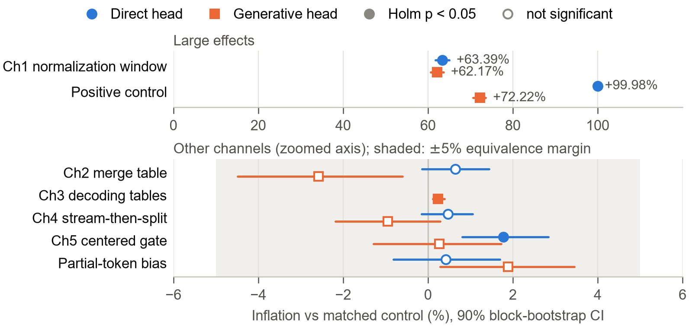

# Final report

**Quantifying Look-Ahead Bias via Causal, Volatility-Aware Motif Tokenization in Financial Time Series**

Devansh Jangid · Aman Gupta · Arnav Tiku · Sanidhya Srivastava · Karan Malik
DA4022 Course Project · NeurIPS 2026 template · 5 pages

📄 **[Read the report (PDF)](final_report.pdf)**

---

## In one paragraph

Motif tokenizers turn a price series into tokens, much as BPE does for text. When one is used to
forecast a single market through time, it can quietly use information from the future. We built a
forecasting pipeline for 5-minute Bitcoin volatility that only looks backwards, then switched on one
possible leak at a time against a matched control. One leak dominates: a normalization window that
sees the forecast period makes forecasts look 63.39% better. The other four leaks are small one hour
ahead but grow one day ahead, where one leak can hide the cost of another.

## Key results

| Finding | Number | Scope |
|---|---|---|
| Normalization window sees the forecast period (Ch1) | **+63.39%** lower forecast error (QLIKE); 62.03% pooled across periods | 6 test periods, 3 training runs |
| Every other leak, one hour ahead | at most **+2.84%** (90% upper bound) | 6 test periods, 3 training runs |
| Only Ch1 beats the best possible score on simulated data | **0.0694** vs the floor of **0.1268** | Simulated GARCH data |
| One day ahead, the leaks grow | Ch1 +96.36%, Ch4 +16.10%, Ch5 +7.02%, Ch2 +5.67% | First test period, 1 run |
| A boundary leak can hide partial-token bias | −19.53% cost, +16.10% won back (0.3137 vs 0.3128) | First test period, 1 run |
| 2025 test set, run only once | Ch1 still **+73.90%**; only GARCH stays in the confidence set | 2025, 1 run |

<p align="center">
  
  <br>
  <em>How much each leak inflates accuracy one hour ahead (Figure 2 of the report).</em>
</p>

## What is in this folder

| File | What it is |
|---|---|
| [`final_report.pdf`](final_report.pdf) | **The final report**: 5 pages including references |
| `main.tex` | Its LaTeX source |
| `refs.bib` | The 13 references |
| `neurips_2026.sty` | The official NeurIPS 2026 style file, unchanged |
| `figures/` | Figure 1 (pipeline) and Figure 2 (inflation per leak) |
| `tables/` | Table 1 (boundary leak vs partial-token bias) |
| `make_figures.py`, `make_tables.py` | Scripts that rebuild Figure 2 and Table 1 from `../results/` and check the quoted numbers |

Every number, table and figure comes from the saved results in [`../results/`](../results). No
experiment was re-run for the report, and the 2025 test set was scored only once.

## Rebuild the PDF

1. On [Overleaf](https://www.overleaf.com), choose **New Project → Upload Project** and upload this
   folder as a zip. It already contains `neurips_2026.sty`.
2. Check that **Menu → Main document** is `main.tex` and the compiler is pdfLaTeX.
3. Click **Recompile**. BibTeX runs automatically.

To rebuild the figures and tables from the results first, run from the repository root:

```bash
python report/make_tables.py    # checks every value against results/ and stops on any mismatch
python report/make_figures.py   # draws the figures from results/*.json
```

## Limitations stated in the report

- One asset, with data from 2021, and a small model trained for five epochs.
- The next-day, 2025, dose-response and token-healing results each come from a single training run.
- The next-day p-values are likely too small, because neighbouring 24-hour targets overlap.
- The partial-token comparison also removes the gate and most volatility tokens.
- The gate and volatility-token ablations planned at the midterm were not run.

See the [main README](../README.md) for the code, the team's contributions and the video.
